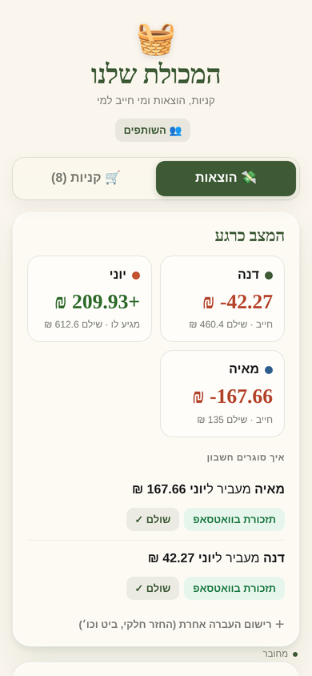
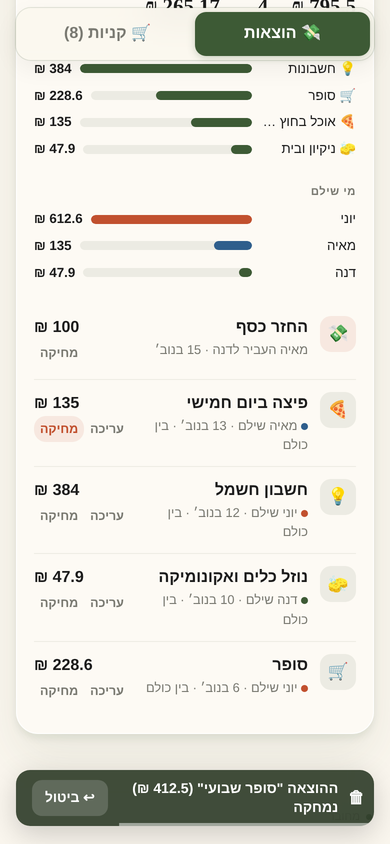
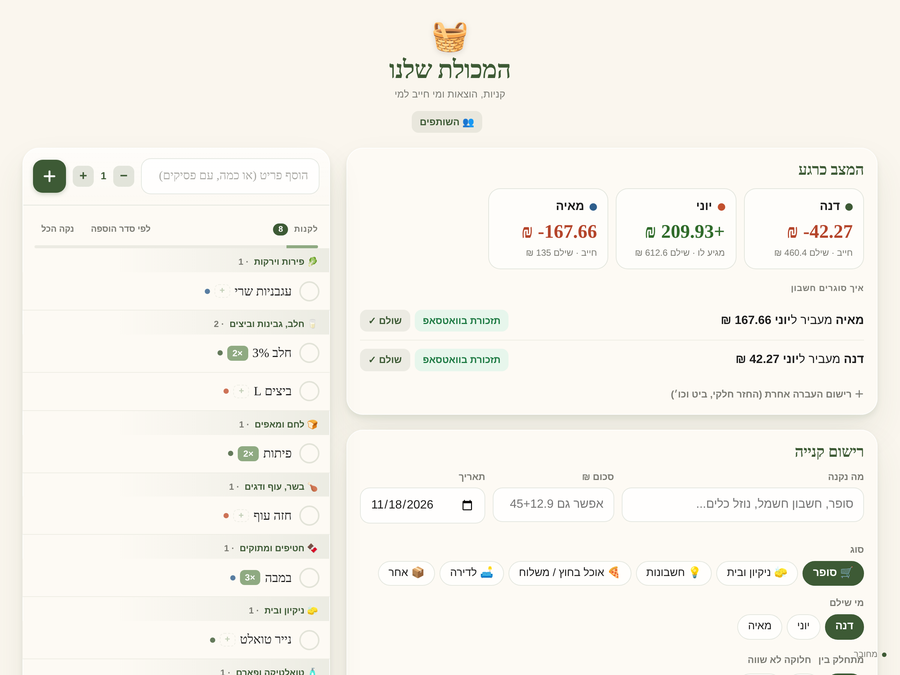

# 🧺 המכולת שלנו — Shared Groceries & Expenses for Roommates

A real-time web app for people who share an apartment: one shared shopping list, and one ledger of who paid for what — with the fewest transfers needed to settle up.

**Live:** https://arielhuna.github.io/shutafim/ · Hebrew, RTL, mobile-first · installs to the home screen · works with no reception

Vanilla HTML/CSS/JS in a single file + Firebase Firestore. No build step, no framework, no backend code.

<p align="center">
  
  
  
</p>

---

## Features

### Shopping list
- Shared in real time between all roommates
- ~630-item Hebrew catalog with autocomplete, sorted into 11 supermarket aisles; free text like `חלב תנובה 3%` is still recognized as dairy
- Add several items at once: `חלב, ביצים, לחם` (or paste a list)
- Swipe right = bought, swipe left = delete; tap `+` / `×N` to raise the quantity
- "Frequently bought" quick-add chips, a dot showing who added each item
- **Record bought items as an expense** — turns the checked-off list into an expense in one step

### Expenses
- Log what, how much, when, type, who paid, and who it's split between — equally or by custom amounts
- The amount field is a calculator: `45+12.9+30`
- Live balance per roommate and the **minimum set of transfers** that settles everyone, with a WhatsApp reminder button
- "Paid ✓", partial/manual transfers, monthly summary by type and by payer, per-roommate filter, export to Excel (CSV)

### Forgiveness instead of "are you sure?"
Every important action happens immediately and offers **↩︎ ביטול** for 7 seconds: new / edited / deleted expenses, settle-ups and transfers, removed roommates, deleted or cleared grocery items. The timer pauses while the toast is touched; `Ctrl/Cmd+Z` works on desktop.

### Feels like an app
- Installable (Android install button, iPhone "Add to Home Screen" hint), home-screen shortcuts to the list or a new expense
- Spring-based, interruptible gestures; bottom sheet that can be dragged to dismiss
- Dark mode, `prefers-reduced-motion`, `prefers-reduced-transparency`, `prefers-contrast`, pinch-zoom kept enabled

<p align="center"></p>

---

## How it works

### Money
All amounts are stored as **integer agorot**, so there are no floating-point rounding errors. An equal split hands out the remainder one agora at a time. Balances are never stored — they are recomputed from the full list of expenses and settlements, so there is no running total that can drift out of sync.

Settling up uses a greedy match of the largest debtor with the largest creditor, which yields at most *n − 1* transfers for *n* roommates.

### Offline and conflicts between phones
Firestore's persistent local cache plus a service worker let the app open and keep working in a supermarket with no signal. What's allowed offline is decided by whether an action can conflict:

| Works offline (synced later) | Needs a live, synced connection |
|---|---|
| Everything in the shopping list | "Paid ✓" and manual transfers |
| Logging a new expense (each is its own document) | Recording bought items as an expense |
| | Editing or deleting history, adding/removing roommates |

"Synced" comes from Firestore's own snapshot metadata (`fromCache === false` on every live query), not just `navigator.onLine`, which can report "online" on a dead network.

Duplicates are prevented by design, not by locking:
- **Grocery items** get an id derived from the name, so the same item added on two phones (even offline) is one document; adding an item that's already listed raises its quantity with an atomic `increment()`.
- **Settle-ups** get an id derived from the current ledger state + debtor + creditor + amount, so two roommates tapping "paid" on the same debt write one record.
- **Expenses from the shopping list** get an id derived from the items *and when each was added* — two phones converting the same list agree, while buying the same items next week still creates a new expense.

### Service worker
Network-first for the page (updates show immediately) with a **3-second timeout** before falling back to the saved copy, so a stalled connection doesn't freeze the app. Only successful responses are cached. Firebase SDK and fonts use stale-while-revalidate; Firestore traffic is never touched.

---

## Security model — read this

- The page password (`PASSWORD` in `index.html`) is checked **in the browser only**. It keeps casual visitors out; it is not access control.
- The Firebase config is public by design. [`firestore.rules`](firestore.rules) therefore validates the **shape** of every write — only the four collections, known fields only, correct types, bounded sizes, hex colors, integer amounts up to ₪100,000 — so the database can't be filled with junk or script injected through it.
- The rules do **not** check *who* writes. Anyone with the project id can still send well-formed writes or deletes. Locking the data to specific people requires Firebase Authentication (e.g. Google sign-in) plus an email allow-list in the rules.
- Everything read from Firestore is treated as untrusted: text is escaped, ids are escaped in attributes, colors must match `#rrggbb`, malformed records are dropped, and CSV cells that Excel would run as formulas are neutralized.

---

## Setup

1. **Firebase:** create a project at [console.firebase.google.com](https://console.firebase.google.com), add **Firestore Database**, and register a **Web app** to get its `firebaseConfig`.
2. **Config:** paste `firebaseConfig` into `index.html` (inside `<script type="module">`), and set your own `PASSWORD`.
3. **Rules:** Firestore → Rules → replace everything with [`firestore.rules`](firestore.rules) → **Publish**. Without this step the database stays fully open.
4. **Deploy:** push to GitHub → Settings → Pages → *Deploy from a branch* → `main` / root.

After changing anything other than `index.html`, bump `VERSION` in `sw.js` so installed copies refresh their cache.

### Data model

| Collection | Fields |
|---|---|
| `groceries` | `name`, `qty` (1–99), `bought`, `cat`, `addedBy`, `createdAt` (server timestamp) |
| `members` | `name`, `color` (`#rrggbb`), `createdAt` |
| `expenses` | `title`, `amount` (agorot), `paidBy`, `splitAmong[]`, `custom` (map of agorot, or `null`), `date` (`YYYY-MM-DD`), `category`, `createdAt` |
| `settlements` | `from`, `to`, `amount` (agorot), `date`, `createdAt` |

### Files

```
index.html             the whole app: markup, styles, logic
firestore.rules        server-side validation of every write
sw.js                  offline app shell
manifest.webmanifest   install metadata, icons, shortcuts
icons/                 app icons (incl. maskable)
docs/                  screenshots
```

---

## Known limitations & ideas

- No real access control (see *Security model*); next step would be Google sign-in with an allow-list.
- No automatic backups — the CSV export doubles as a manual backup.
- Two people editing the *same* expense at the same moment: the last save wins.
- Ideas: a shared catalog that learns the household's own product names; one-tap category fixes for items that land in "אחר".
